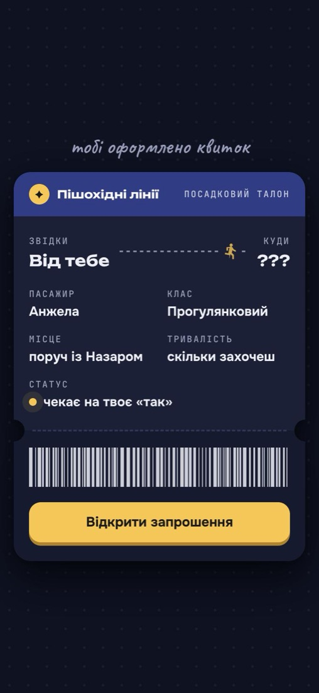
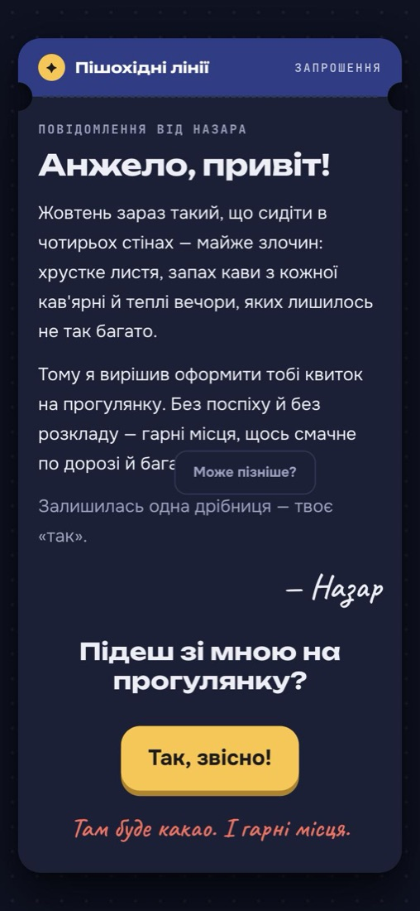
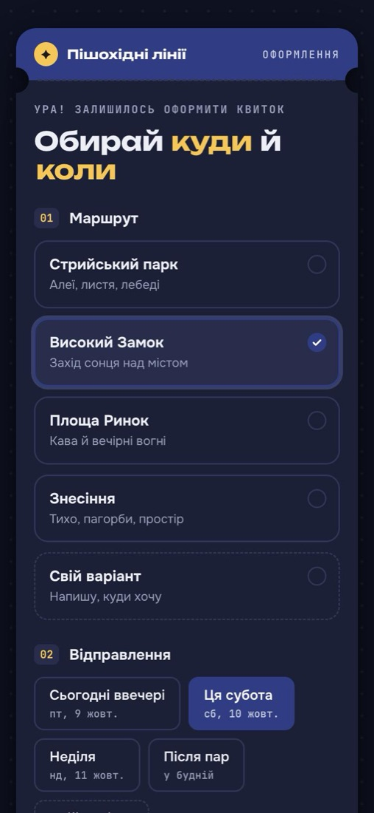
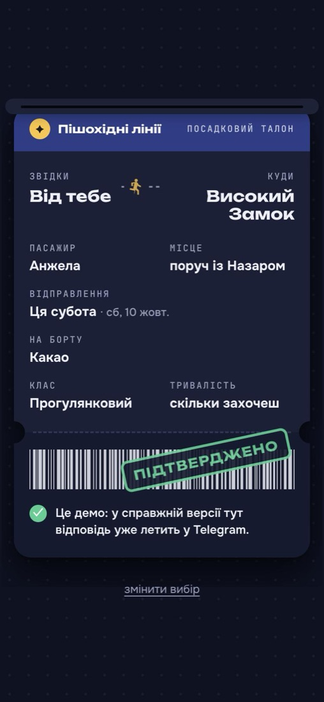

# Квиток на прогулянку

Інтерактивне веб-запрошення на прогулянку у стилі посадкового талона. Одержувач проходить короткий сценарій — від «квитка» до вибору місця й часу, — а відповідь миттєво надходить відправнику в Telegram і зберігається в Google Sheets. Власного сервера немає: статичний фронтенд і Google Apps Script як бекенд.

**[Демо](https://walk-ticket-invitation.netlify.app/?demo&to=%D0%90%D0%BD%D0%B6%D0%B5%D0%BB%D0%B0)** — працює повністю, але відповіді не надсилаються.

<p align="center">
  
  
  
  
</p>

---

## Що він робить

Сценарій складається з чотирьох екранів:

1. **Квиток** — обкладинка з іменем одержувача.
2. **Запрошення** — особистий лист і питання з двома кнопками. Кнопка «Ні» з кожною спробою зменшується й переміщується у випадкове вільне місце екрана, ніколи не перекриваючи «Так», яка тим часом збільшується.
3. **Оформлення** — вибір маршруту, часу (дати підставляються автоматично) і того, що взяти з собою. У кожному блоці можна вписати власний варіант.
4. **Підтвердження** — «надрукований» квиток із підсумком. Одночасно відповідь надсилається на бекенд.

---

## Ключові можливості

- **Персональні посилання** — `?to=Анжела` змінює ім'я в усьому сценарії, кличний відмінок («Анжело, привіт!») визначається автоматично. Сторінка `make.html` генерує готові посилання.
- **Сповіщення в Telegram** — про відкриття запрошення, підтвердження й зміну вибору, разом із кількістю спроб натиснути «Ні».
- **Google Sheets як сховище** — кожна подія записується окремим рядком.
- **Тестовий і демо-режими** — `?test=1` позначає відповіді як тестові, `?demo` повністю вимикає надсилання.
- **Робота без мережі** — якщо запит не пройшов, квиток однаково показується з пропозицією зробити скріншот.
- **Адаптивний інтерфейс** — мобільні й десктопні екрани, світла й темна теми, підтримка `prefers-reduced-motion`.
- **Конфігурація без коду** — усі тексти, імена й варіанти зібрані в `site/config.js`.

---

## Архітектура

```
┌───────────┐   GET    ┌───────────┐
│  Браузер  │ ───────► │  Netlify  │   статичні файли з site/
│           │          └───────────┘
│           │   POST   ┌──────────────────────┐  appendRow    ┌───────────────┐
│           │ ───────► │  Google Apps Script  │ ────────────► │ Google Sheets │
└───────────┘          │  Web App (doPost)    │               └───────────────┘
                       │                      │  sendMessage  ┌───────────────┐
                       │                      │ ────────────► │ Telegram Bot  │
                       └──────────────────────┘               └───────────────┘
```

- Фронтенд надсилає JSON із `Content-Type: text/plain`, щоб браузер не робив CORS preflight-запит, який Apps Script не підтримує.
- Токен бота й chat id зберігаються в Script Properties Apps Script, адреса бекенду — у локальному `site/env.js`. Ні те, ні інше не потрапляє в репозиторій.
- Запис у таблицю захищено `LockService`, текст від користувача екранується від формул і HTML.

```
site/
├── index.html         екрани запрошення
├── make.html          генератор персональних посилань
├── config.js          тексти, імена й варіанти вибору
├── env.example.js     шаблон для env.js з адресою бекенду
├── app.js             логіка сценарію, кнопки «Ні» та надсилання
├── names.js           кличний відмінок і розбір параметрів URL
└── style.css          стилі
apps-script/
└── Code.gs            бекенд: прийом відповіді, запис у таблицю, Telegram
```

---

## Технології

| Шар | Технологія |
|---|---|
| Фронтенд | HTML, CSS, JavaScript — без фреймворків, залежностей і збірки |
| Бекенд | Google Apps Script (Web App) |
| Сховище | Google Sheets |
| Сповіщення | Telegram Bot API |
| Хостинг | Netlify |

---

## Швидкий старт

### Локально

```bash
cp site/env.example.js site/env.js
open site/index.html
```

Без адреси бекенду сценарій працює повністю, але відповідь не надсилається.

### Бекенд

1. Створіть Google Таблицю, відкрийте **Розширення → Apps Script** і вставте вміст `apps-script/Code.gs`.
2. Створіть бота через [@BotFather](https://t.me/BotFather) і напишіть йому `/start`.
3. У **Project Settings → Script Properties** додайте `TELEGRAM_TOKEN`.
4. Запустіть функцію `setupTelegram` — вона збереже `CHAT_ID` і надішле тестове повідомлення.
5. **Deploy → New deployment → Web app**, *Execute as: Me*, *Who has access: Anyone*. Скопіюйте URL, що закінчується на `/exec`.

Після змін у `Code.gs` оновлюйте наявне розгортання (**Manage deployments → Edit → New version**) — так URL залишиться тим самим.

### Фронтенд

1. Вставте URL бекенду в `site/env.js`.
2. Налаштуйте тексти й варіанти в `site/config.js`.
3. Завантажте папку `site/` на Netlify (наприклад, через [Netlify Drop](https://app.netlify.com/drop)) або будь-який інший статичний хостинг.

---

## Параметри URL

| Параметр | Приклад | Опис |
|---|---|---|
| `to` | `?to=Анжела` | Ім'я одержувача. Без параметра використовується значення з `config.js` |
| `v` | `&v=Анжелочко` | Звертання вручну, якщо автоматичне не підходить |
| `test` | `?test=1` | Позначає відповіді як тестові в таблиці й Telegram |
| `demo` | `?demo` | Вимикає надсилання відповідей |

---

## Формат даних

Фронтенд надсилає на бекенд дві події:

```json
{ "type": "open", "to": "Анжела", "test": false }
```

```json
{
  "type": "answer",
  "revision": 1,
  "to": "Анжела",
  "place": "Високий Замок",
  "when": "Ця субота",
  "whenDate": "сб, 10 жовт.",
  "treat": "Какао",
  "comment": "",
  "noClicks": 3,
  "test": false
}
```

Кожна подія стає рядком аркуша «Відповіді»:

| Час | Подія | Тест | Кому | Куди | Коли | Дата | По дорозі | Побажання | Скільки разів «Ні» |
|---|---|---|---|---|---|---|---|---|---|
